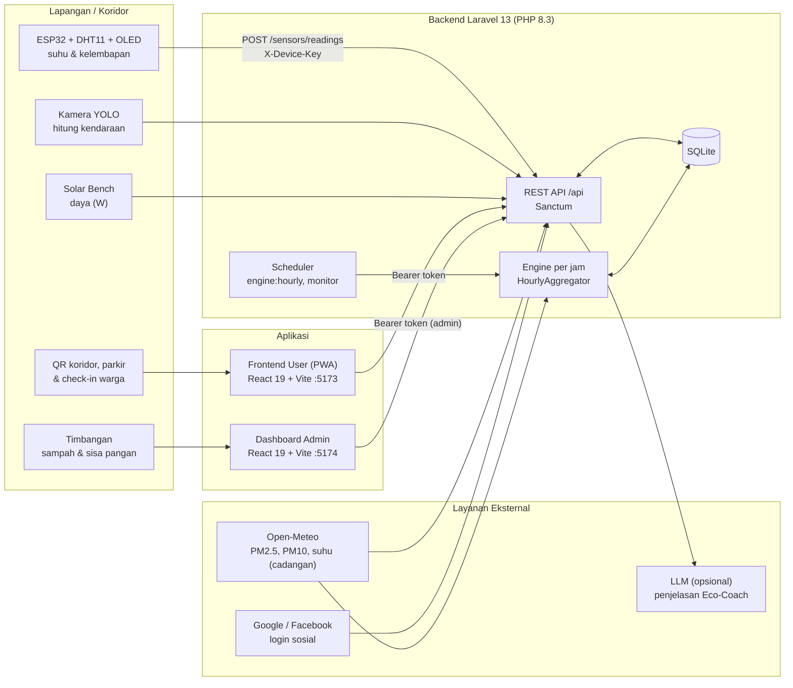
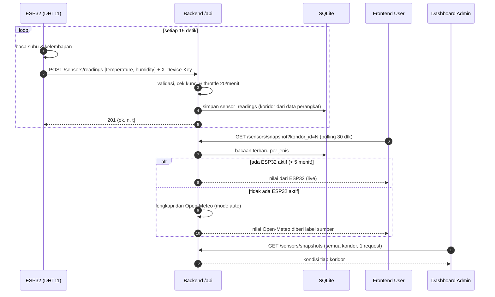
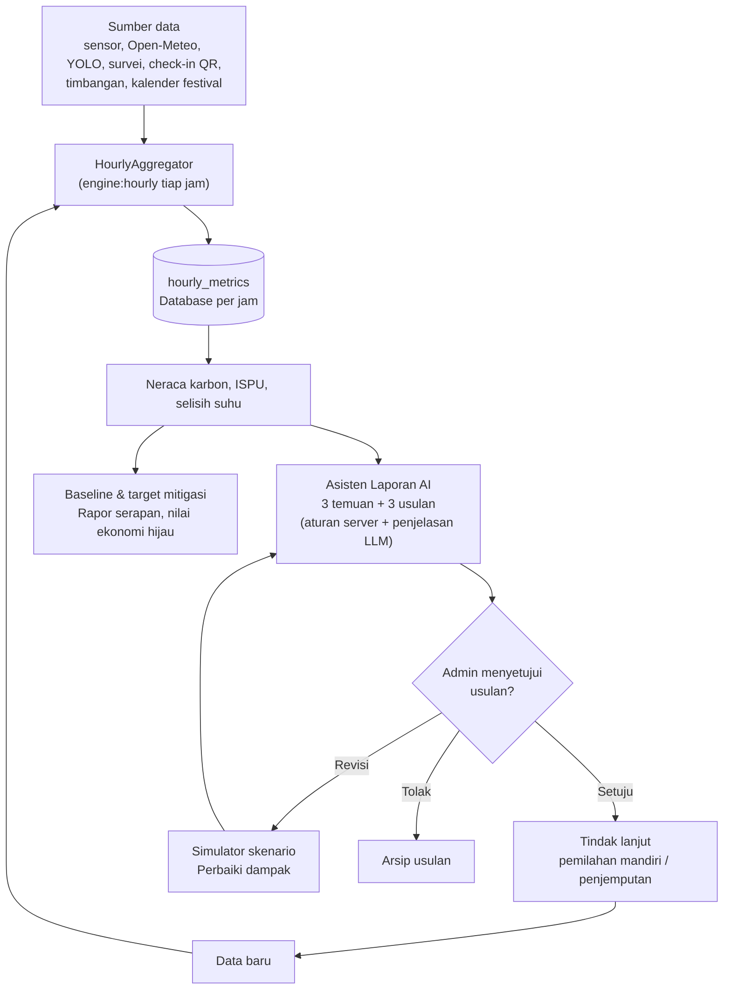
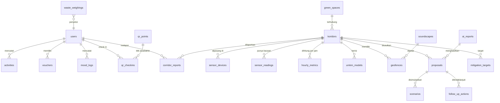

# JEJAK WANGI — Digital Twin & Restorative Green-Wellness Corridor

> Platform pemantauan dan pengelolaan koridor trotoar hijau di Banyuwangi: sensor IoT (ESP32) → server lokal → aplikasi warga & dashboard pengelola, dengan neraca karbon per jam, asisten laporan AI, dan gamifikasi jalan kaki.

**Daftar isi**

1. [Pengenalan Projek](#1-pengenalan-projek)
2. [Technical Documentation](#2-technical-documentation)
3. [Frontend Documentation](#3-frontend-documentation)
4. [Backend Documentation](#4-backend-documentation)
5. [Petunjuk Localhost](#5-petunjuk-localhost)
6. [Pemecahan Masalah](#6-pemecahan-masalah)
7. [Atribusi & Lisensi Data](#7-atribusi--lisensi-data)

---

## 1. Pengenalan Projek

### 1.1 Gambaran solusi

**JEJAK WANGI** mengubah koridor trotoar yang menghubungkan **Taman Sritanjung dan Taman Blambangan** (Banyuwangi) menjadi *Restorative Green-Wellness Corridor*. Sistem ini terdiri dari tiga bagian yang bekerja sebagai satu kesatuan:

| Bagian | Fungsi | Pengguna |
|---|---|---|
| **Frontend User (PWA)** | Aplikasi warga: kondisi udara/suhu koridor secara langsung, navigasi rute hijau, terapi suara (*soundscape*), pencatat suasana hati, notifikasi berbasis lokasi (*geofencing*), check-in QR jalan kaki, lapor koridor, kupon & poin, Eco-Coach (asisten AI) | Warga, pejalan kaki, wisatawan |
| **Dashboard Admin** | Pemantauan sensor & koridor, kalender festival, manajemen perangkat IoT, laporan warga, sampah & pangan, neraca karbon, usulan tindak lanjut dari Asisten Laporan AI | Pengelola koridor / dinas terkait, petugas lapangan |
| **Backend API (Laravel)** | Menerima data sensor ESP32, menyimpan, menghitung ISPU & neraca karbon per jam, mengelola autentikasi dan seluruh data aplikasi | Dipakai kedua aplikasi di atas |

Ciri utama:

- **Data lingkungan nyata** dari ESP32 (suhu & kelembapan DHT11, dapat diperluas ke sensor lain). Selama ESP32 aktif, data **selalu** diambil dari ESP32; **Open-Meteo** hanya menjadi cadangan saat tidak ada sensor aktif.
- **Neraca karbon per jam** per koridor: serapan pohon + emisi terhindar (jalan kaki, surya, kantong plastik) − emisi AC − emisi kendaraan.
- **Siklus keputusan lengkap**: data → olah → temuan & usulan (AI + aturan server) → persetujuan admin → tindak lanjut → data baru.
- **Mode data pengganti (seder)** yang ditandai jelas, agar seluruh alur dapat diuji end-to-end walau data lapangan belum ada.

### 1.2 Latar belakang

Koridor pejalan kaki di pusat kota umumnya tidak punya data terukur: berapa suhu di bawah kanopi dibanding area terbuka, seberapa baik kualitas udaranya, dan seberapa besar dampak karbon dari pohon, toko ber-AC, serta kendaraan di sekitarnya. Tanpa data itu, pengelola sulit memutuskan intervensi (tambah pohon, atur parkir, kelola sampah pasar), dan warga tidak punya alasan kuat untuk memilih berjalan kaki.

JEJAK WANGI menjawabnya dengan menjadikan koridor sebagai **digital twin**: kondisi fisik (sensor, survei pohon & AC, kamera kendaraan, timbangan sisa pangan, kalender festival) dicerminkan ke satu basis data per jam, lalu dipakai untuk (a) memberi informasi kepada warga dan (b) mendukung keputusan pengelola.

Proyek ini dikembangkan oleh tim **Happy Fun Angkasa**, SMK Negeri 1 Banyuwangi.

### 1.3 Target pengguna

| Pengguna | Kebutuhan | Fitur utama |
|---|---|---|
| **Warga & pejalan kaki** | Tahu kondisi udara/suhu sebelum berjalan, rute teduh, kegiatan yang menyehatkan | Beranda ISPU & suhu, Smart Green Route, Soundscape, Mood Tracker, Check-in QR, Dampak & poin, Kupon |
| **Pelaku UMKM / kasir** | Mendukung kebiasaan bawa tas/tempat sendiri | Halaman Kasir, token *Bring Your Own* (BYO) |
| **Wisatawan / peserta festival** | Info acara dan lokasi | Banyuwangi Festival, peta koridor |
| **Pengelola / admin** | Memantau sensor, laporan warga, dan dampak karbon; menyetujui tindak lanjut | Dashboard Admin |
| **Petugas lapangan** | Menimbang sampah/pangan, menindaklanjuti laporan | Sampah & Pangan, Lapor Koridor |

---

## 2. Technical Documentation

### 2.1 Arsitektur sistem



**Prinsip arsitektur**

- **Satu backend, dua klien.** Seluruh data dan autentikasi hanya ada di backend Laravel; frontend tidak menyimpan basis data sendiri.
- **Autentikasi perangkat terpisah dari pengguna.** ESP32 memakai header `X-Device-Key` (kunci di-*hash* SHA-256 di database, tampil sekali saat dibuat). Pengguna memakai token Laravel Sanctum.
- **Koridor ditentukan server, bukan payload.** `device_code` dan `koridor_id` diambil dari baris perangkat sehingga satu perangkat tidak bisa menyamar sebagai perangkat lain.
- **Data segar vs data lama.** Bacaan < 5 menit dianggap *live*; lebih lama tetap ditampilkan sebagai "data lama" dari database (`is_stale`).
- **Prioritas sumber data:** ESP32 aktif → Open-Meteo (cadangan, hanya untuk jenis data yang tidak diukur ESP32, dapat dimatikan) → data seder.

### 2.2 Diagram alur: sensor ESP32 sampai tampil di aplikasi



### 2.3 Diagram alur: siklus penuh (data → keputusan → tindak lanjut)



Rumus neraca per jam per koridor (`HourlyAggregator`):

```
neraca = serapan pohon + emisi terhindar (jalan kaki + surya + kantong plastik) − emisi AC − emisi kendaraan
```

Positif berarti koridor **surplus** (menyerap lebih banyak daripada memancarkan). Asumsi angka (harga karbon, faktor emisi, dll.) ada di `backend/config/jejakwangi.php` dan **perlu dikonfirmasi** karena belum seluruhnya data resmi; data survei koridor yang berlabel *ILUSTRASI* ditandai pada kolom `sumber`.

Pemetaan lengkap flowchart ke kode ada di `backend/docs/ALUR_FLOWCHART.md`.

### 2.4 Teknologi

| Lapisan | Teknologi |
|---|---|
| Backend | PHP ≥ 8.3, Laravel 13, Laravel Sanctum, SQLite, PHPUnit |
| Frontend | React 19, Vite, React Router 7, Tailwind CSS 4, Leaflet / React-Leaflet (OpenStreetMap), Vitest |
| IoT | ESP32, DHT11, OLED SSD1306, Arduino (HTTP/HTTPS) |
| Layanan luar | Open-Meteo (gratis, tanpa API key), LLM kompatibel OpenAI/Anthropic (opsional), Google/Facebook Login (opsional) |

---

## 3. Frontend Documentation

Terdapat dua aplikasi frontend, keduanya **React 19 + Vite + Tailwind CSS 4**.

### 3.1 Frontend User — `frontend-user/` (PWA, port 5173)

**Framework & pustaka:** React 19, React Router DOM 7, Tailwind CSS 4, Leaflet + React-Leaflet, `qrcode`, service worker (`public/sw.js`) + `manifest.webmanifest` untuk PWA. Uji dengan Vitest + Testing Library.

**Struktur direktori**

```
frontend-user/
├── index.html
├── vite.config.js               # port 5173, host: true, konfigurasi Vitest
├── .env.example                 # → salin ke .env.local
├── public/                      # favicon, manifest PWA, sw.js
└── src/
    ├── main.jsx, App.jsx        # entry & definisi rute
    ├── index.css                # Tailwind + token desain
    ├── pages/                   # satu berkas = satu layar (±40 halaman)
    ├── components/
    │   ├── global/              # Button, Card, Icon, PollutantCard, EnvGauge, EcoCoach,
    │   │                        # IspuLegend, KodeQr, Skeleton, SmartImage, StatusPill, ...
    │   ├── layout/              # PageShell, BottomNav, TopStatusBar
    │   ├── map/                 # BaseTileLayer, FitBounds, LocateControl
    │   ├── geofencing/          # GeofenceAlert
    │   └── auth/                # SocialLoginButtons
    ├── hooks/                   # useSensorReading, useSensorSnapshot, usePolling,
    │                            # useActiveKoridor, useGeofence, useKoridorRoutes, ...
    ├── services/                # akses API (laravelClient + service per domain)
    ├── context/                 # GeofenceContext
    ├── lib/                     # ispu, carbonBalance, geo, journey, roadSnap, mapTiles, ...
    ├── data/                    # data mock (dipakai bila backend tidak diatur)
    ├── assets/pages/            # gambar per halaman (home, koridor, map, mood, ...)
    └── __tests__/               # Vitest
```

**Rute utama**

| Rute | Halaman |
|---|---|
| `/`, `/onboarding`, `/login` | Splash, onboarding, masuk (email / Google / Facebook) |
| `/home` | Beranda: ISPU, suhu, kelembapan, kartu polutan, Eco-Coach |
| `/koridor`, `/koridor/:id` | Daftar & detail koridor |
| `/map` | Peta koridor (Leaflet + OSM) |
| `/route`, `/route/pilih`, `/route/detail/:id`, `/route/detail/:id/navigasi` | Smart Green Route & navigasi |
| `/mood`, `/mood/riwayat`, `/soundscape`, `/geofencing` | Mood tracker, terapi suara, geofencing |
| `/bfest`, `/umkm` | Banyuwangi Festival, UMKM |
| `/scan`, `/q/:koridorId`, `/scan/akhir/:id`, `/scan/tempat-sendiri`, `/kasir`, `/parkir`, `/checkin` | Alur QR: check-in jalan kaki, bawa tas sendiri (BYO), parkir |
| `/lapor`, `/timbangan` | Lapor koridor, timbangan sampah/pangan |
| `/dampak`, `/aktivitas`, `/misi`, `/kupon`, `/profil` | Dampak & SDGs, aktivitas, misi, kupon, profil |
| `/charger`, `/charger/:id`, `/charger/:id/isi` | Stasiun pengisian surya |
| `/eco-coach` | Chat Eco-Coach |

**Pola data:** `services/sensorService.js` memakai dua endpoint (`/sensors/snapshot` dan `/sensors/active`); `useSensorReading` mengubah `is_stale` menjadi `source: 'live' | 'db'` dan `origin: 'sensor' | 'open-meteo'` sehingga kartu menampilkan "Live", "Live · Open-Meteo", atau "Data lama". Bila `VITE_LARAVEL_API_URL` kosong, aplikasi memakai data mock lokal (`src/data/`) untuk pengembangan UI.

**Aset:** gambar halaman di `src/assets/pages/<halaman>/`, ikon dalam komponen `Icon.jsx` / `customIcons.js`, peta memakai tile OpenStreetMap (dapat diganti MapTiler lewat `VITE_MAP_TILE_URL`).

### 3.2 Dashboard Admin — `dashboard-admin/` (port 5174)

**Framework & pustaka:** React 19, React Router 7, Tailwind CSS 4, Leaflet, `lucide-react`, font Poppins (`@fontsource/poppins`).

```
dashboard-admin/
├── index.html
├── vite.config.js               # port 5174
├── .env.example                 # VITE_API_URL
├── dev/                         # mock-api.mjs + seed.json (preview tanpa backend)
├── public/images/               # aset koridor, UMKM, geofencing
└── src/
    ├── main.jsx, App.jsx        # rute (semua di balik login admin)
    ├── pages/                   # Dashboard, Monitoring, SensorIot, Festival, Geofencing,
    │                            # Mood, Reports, SampahPangan, LaporKoridor, TindakLanjut,
    │                            # CaraMenghitung, Users, Notifications, Settings, ...
    ├── components/
    │   ├── ui/                  # Badge, Button, Card, Field, Modal, Pagination, StatCard, Tabs, ...
    │   ├── layout/              # AppLayout, Sidebar
    │   ├── charts/              # Charts
    │   ├── map/                 # MapView
    │   └── AsistenLaporan.jsx   # Asisten Laporan AI
    ├── context/                 # Auth, Notif, Settings, Toast
    ├── hooks/                   # useAsync, useEnvironment
    ├── lib/                     # api (klien HTTP), env (kondisi lingkungan), ispu, format, routing
    ├── services/jejakwangi.js   # semua pemanggilan endpoint dikelompokkan di sini
    └── __tests__/               # Vitest
```

**Halaman ↔ rute**

| Rute | Fungsi |
|---|---|
| `/login` | Masuk (hanya akun `is_admin`) |
| `/` Dashboard | Ringkasan, peta, status sensor |
| `/monitoring`, `/monitoring/koridor/:id?` | Pemantauan AQI, suhu, kelembapan; tren & detail koridor |
| `/sensor-iot` | CRUD perangkat, kunci API (tampil sekali), mode perawatan |
| `/sampah-pangan`, `/lapor-koridor` | Penimbangan & laporan warga |
| `/tindak-lanjut`, `/cara-menghitung` | Asisten Laporan AI, usulan, simulator, baseline; penjelasan rumus |
| `/smart-green-route`, `/kalender-festival`, `/geofencing`, `/mood-wellbeing`, `/jejak-wangi` | Modul konten & analitik |
| `/laporan`, `/pengguna`, `/notifikasi`, `/pengaturan` | Laporan ekspor, pengguna, notifikasi, pengaturan & backup |

Badge **Sumber** pada tabel suhu membedakan *Sensor live*, *Open-Meteo (cadangan)*, dan *Baseline*.

---

## 4. Backend Documentation

**Stack:** Laravel 13, PHP ≥ 8.3, Sanctum, SQLite. Basis URL lokal: `http://localhost:8000/api`.

### 4.1 Struktur direktori

```
backend/
├── app/
│   ├── Http/Controllers/Api/    # controller per domain (Sensor, Auth, Koridor, Waste, Engine, ...)
│   ├── Http/Middleware/         # AuthenticateDevice (X-Device-Key), EnsureUserIsActive
│   ├── Http/Resources/          # format JSON
│   ├── Models/                  # model Eloquent
│   ├── Services/                # OpenMeteoAir, Ispu, EcoCoach/*, Engine/* (HourlyAggregator,
│   │                            # CarbonBalance, Simulator, ProposalWorkflow, ...)
│   └── Console/Commands/        # engine:hourly, jejakwangi:monitor, jejakwangi:cycle-check, ...
├── config/                      # jejakwangi.php (asumsi karbon), openmeteo.php, ecocoach.php, cors.php
├── database/{migrations,seeders}
├── routes/{api.php,console.php}
├── docs/                        # ALUR_FLOWCHART.md, eco-coach.md
└── tests/Feature/               # uji API & uji satu siklus (FullCycleTest)
```

### 4.2 Autentikasi & batas laju

| Jenis | Cara | Keterangan |
|---|---|---|
| Publik | tanpa header | data umum (koridor, festival, sensor snapshot) |
| Pengguna | `Authorization: Bearer <token>` | token Sanctum dari `/auth/login`, masa berlaku `SANCTUM_EXPIRATION` |
| Admin | Bearer + `is_admin = true` | seluruh `/api/admin/*` |
| Perangkat | `X-Device-Key: svg_...` (atau Bearer) | khusus `POST /sensors/readings` |

Batas laju: sensor 20 kiriman/menit per perangkat, Eco-Coach 10/menit, mood 60/menit per IP, login/registrasi/login sosial dibatasi per IP.

### 4.3 API endpoints

**Publik**

| Method | Endpoint | Fungsi |
|---|---|---|
| GET | `/koridors`, `/koridors/{id}` | Daftar & detail koridor |
| GET | `/green-spaces` | Ruang hijau |
| GET | `/umkm`, `/umkm/{id}` | UMKM |
| GET | `/festivals`, `/festivals/{id}` | Banyuwangi Festival |
| GET | `/soundscapes`, `/soundscapes/{id}` | Terapi suara |
| GET | `/geofences` | Geofence |
| GET | `/sensors/snapshot?koridor_id=` | Bacaan terbaru semua jenis sensor satu koridor |
| GET | `/sensors/snapshots` | Snapshot semua koridor sekaligus |
| GET | `/sensors/active` | Koridor yang sedang aktif (kartu ISPU beranda) |
| GET | `/sensors/history?sensor_type=&koridor_id=&days=` | Tren harian (1–90 hari) |
| POST | `/eco-coach` | Tanya Eco-Coach |
| POST | `/mood-logs` · GET `/mood-logs/summary` | Catat & ringkas suasana hati |
| GET | `/leaderboard`, `/chargers`, `/chargers/{id}` | Peringkat, stasiun pengisian |

**Perangkat IoT**

| Method | Endpoint | Fungsi |
|---|---|---|
| POST | `/sensors/readings` | Kirim bacaan (header `X-Device-Key`) |

Contoh dari ESP32 (payload datar, koridor diambil dari data perangkat):

```http
POST /api/sensors/readings
X-Device-Key: svg_xxxxxxxx
Content-Type: application/json

{"temperature": 30.2, "humidity": 70}
```
```json
{"ok": true, "n": 2, "t": 1790000000}
```

Jenis sensor yang diterima: `temperature`, `humidity`, `air_quality`, `pm25`, `pm10`, `so2`, `co`, `o3`, `no2`, `co2`, `o2`, `temperature_open`, `solar_w`, `vehicle_motor`, `vehicle_car`. Bentuk multi-wilayah (`{"wilayah":[{"no":1,...}]}`) dan field `aktif` juga didukung.

Contoh balasan `GET /sensors/snapshot?koridor_id=1`:

```json
{
  "koridor_id": "1",
  "updated_at": "2026-11-14T08:15:00+00:00",
  "is_stale": false,
  "readings": {
    "temperature": {"sensor_type": "temperature", "value": 30.2, "unit": "°C", "recorded_at": "...", "is_stale": false},
    "pm25": {"value": 30, "unit": "µg/m³", "is_stale": false, "source": "open-meteo"}
  }
}
```
Field `source: "open-meteo"` hanya muncul pada nilai yang berasal dari Open-Meteo.

**Autentikasi**

| Method | Endpoint | Fungsi |
|---|---|---|
| POST | `/auth/register`, `/auth/login` | Daftar, masuk |
| POST | `/auth/social` · GET `/auth/providers` | Login Google/Facebook |
| GET | `/auth/me` · POST `/auth/logout` | Profil, keluar |

**Pengguna terautentikasi** (`auth:sanctum`)

| Method | Endpoint | Fungsi |
|---|---|---|
| POST/GET | `/activities`, `/me/summary` | Aktivitas jalan kaki, ringkasan |
| POST/GET | `/checkins/start`, `/checkins/{id}/finish`, `/me/checkins` | Check-in QR |
| GET | `/qr/parkir/{kode}` | Saran parkir berdasarkan ISPU |
| POST | `/byo/token`, `/byo/confirm` | Bawa tempat sendiri |
| GET/POST | `/reports/meta`, `/reports`, `/me/reports`, `/reports/{id}/respond` | Lapor koridor |
| POST/GET | `/waste/checkin`, `/waste/mine`, `/waste/{id}/confirm`, `/waste/{id}/correction` | Sampah & pangan |
| GET | `/me/impact`, `/rewards` · POST `/rewards/redeem` | Dampak & hadiah |
| GET/POST | `/vouchers`, `/vouchers/tiers`, `/vouchers/claim`, `/vouchers/{id}/redeem` | Kupon |

**Admin** (`/api/admin/...`)

| Kelompok | Endpoint |
|---|---|
| Pengguna & notifikasi | `GET/POST /users`, `PUT/DELETE /users/{id}`, `GET /activity-monthly`, `GET /notifications`, `POST /notifications/mark-read` |
| Sensor IoT | `GET/POST /sensor-devices`, `PUT/DELETE /sensor-devices/{id}`, `POST /sensor-devices/{id}/rotate-key` |
| Laporan koridor | `GET/POST /reports`, `GET/POST /reports/{id}` |
| Sampah & pangan | `GET /waste`, `/waste/meta`, `/waste/summary`, `/waste/checkins`; `POST /waste`; `GET/PUT/DELETE /waste/{id}`; `POST /waste/{id}/process` |
| Engine | `GET /engine/sumber`, `/engine/hourly`, `/engine/neraca`, `/engine/rapor`, `/engine/ekonomi`, `/engine/baseline`, `/engine/skenario`; `POST /engine/recompute`, `/engine/baseline`, `/engine/simulasi` |
| Asisten & usulan | `POST /asisten/laporan`, `GET /proposals`, `POST /proposals/{id}/setuju`, `/tolak`, `/revisi` |
| Tindak lanjut & QR | `GET/POST /follow-ups`, `PUT /follow-ups/{id}`, `GET/POST /qr-points` |
| Konten | `POST/PUT/DELETE /geofences`, `/festivals` |
| Pengaturan | `GET/PUT /settings`, `POST /backup`, `GET /backup/download`, `GET /jejak-wangi/summary`, `POST /eco-coach/laporan` |

> Daftar lengkap & terkini: `php artisan route:list --path=api`.

### 4.4 Database schema

Database: **SQLite** (`database/database.sqlite`), dikelola lewat migrasi (`php artisan migrate`).



Tabel utama dan kolom penting:

| Kelompok | Tabel | Kolom penting |
|---|---|---|
| Pengguna | `users` | name, email, password, is_admin, is_active, google_id, facebook_id, bonus_points |
| | `personal_access_tokens`, `sessions`, `cache`, `jobs` | infrastruktur Laravel/Sanctum |
| Koridor & konten | `koridors` | short_name, formal_name, path (jalur), hijau_level/score, shade_score, carbon_inputs (survei pohon & AC), oxygen_kg_day, co2_reduced_kg_day |
| | `green_spaces`, `umkm_models`, `festival_models`, `soundscapes`, `geofences`, `charger_stations` | konten & lokasi |
| Sensor | `sensor_devices` | device_code, koridor_id, key_hash, is_active, is_maintenance, last_seen_at |
| | `sensor_readings` | device_code, koridor_id, sensor_type, value, recorded_at |
| Aktivitas warga | `activities`, `vouchers`, `voucher_cooldowns`, `byo_tokens`, `mood_logs` | jarak, kalori, CO₂, poin, kupon, suasana hati |
| QR & check-in | `qr_points`, `qr_checkins` | jarak, durasi, kecepatan, co2_kg, plastik_pcs, points, status |
| Laporan & sampah | `corridor_reports`, `waste_weighings`, `waste_checkins` | status, kategori; berat organik/anorganik/pangan, poin |
| Engine | `hourly_metrics` | koridor_id, hour_at, ispu, pm25/pm10, suhu_kanopi/terbuka, selisih_suhu, kendaraan, serapan_kg, emisi_*_kg, neraca_kg, sumber |
| | `ai_reports`, `proposals`, `scenarios`, `mitigation_targets`, `follow_up_actions`, `reward_redemptions` | siklus temuan → usulan → simulasi → tindak lanjut |
| Admin | `admin_notifications`, `app_settings` | notifikasi & pengaturan |

Seeder (`php artisan db:seed`) mengisi koridor, UMKM, festival, geofence, sensor contoh, akun admin, dan data demo satu siklus (`DemoCycleSeeder`, perangkat berkode `seed-*`).

### 4.5 Perintah Artisan

| Perintah | Fungsi |
|---|---|
| `php artisan engine:hourly` | Tarik Open-Meteo & hitung Database per jam untuk jam lalu (dijadwalkan tiap jam) |
| `php artisan engine:hourly --dari=YYYY-MM-DD --sampai=YYYY-MM-DD --tanpa-api` | Hitung ulang rentang tanggal |
| `php artisan jejakwangi:cycle-check [--seed]` | Cek satu siklus penuh (opsi `--seed` mengisi data seder 48 jam) |
| `php artisan jejakwangi:monitor` | Sensor offline & AQI tinggi → notifikasi (tiap 5 menit) |
| `php artisan sensors:prune` | Hapus bacaan lama sesuai retensi |
| `php artisan devices:register KODE --koridor=1` | Daftarkan perangkat dari CLI |

### 4.6 `.env.example`

Berkas ini sudah ada di `backend/.env.example`. Isi pentingnya:

```env
APP_NAME="JEJAK WANGI"
APP_ENV=local
APP_DEBUG=true
APP_URL=http://localhost:8000

# Domain frontend yang boleh memanggil API (pisahkan dengan koma)
CORS_ALLOWED_ORIGINS=http://localhost:5173,http://localhost:5174
# Masa berlaku token login (menit). 43200 = 30 hari
SANCTUM_EXPIRATION=43200

APP_LOCALE=en
APP_FALLBACK_LOCALE=en
BCRYPT_ROUNDS=12

LOG_CHANNEL=stack
LOG_STACK=single
LOG_LEVEL=debug

# Database (SQLite). Kosongkan DB_DATABASE → database/database.sqlite
DB_CONNECTION=sqlite
# DB_DATABASE=/path/absolut/ke/database.sqlite

SESSION_DRIVER=database
SESSION_LIFETIME=120
QUEUE_CONNECTION=database
CACHE_STORE=database
FILESYSTEM_DISK=local
MAIL_MAILER=log

# Akun admin dari seeder (lokal default: admin@jejakwangi.id / jejakwangi123)
# ADMIN_SEED_EMAIL=admin@jejakwangi.id
# ADMIN_SEED_PASSWORD=ganti-di-produksi

# Login sosial (opsional; kosong = tombol disembunyikan)
GOOGLE_CLIENT_ID=
FACEBOOK_APP_ID=
FACEBOOK_APP_SECRET=

# Eco-Coach (AI). API key hanya di server. Kosongkan LLM_PROVIDER = template cadangan tanpa AI
# LLM_PROVIDER=openai          -> OPENAI_API_KEY, LLM_BASE_URL, LLM_MODEL
# LLM_PROVIDER=anthropic       -> ANTHROPIC_API_KEY, LLM_MODEL
LLM_PROVIDER=
LLM_MODEL=
LLM_BASE_URL=
LLM_TIMEOUT_MS=15000

# Open-Meteo (gratis, tanpa key)
#   off       = hanya sensor ESP32
#   auto      = ESP32 diutamakan, Open-Meteo hanya cadangan (disarankan)
#   openmeteo = selalu Open-Meteo, KECUALI jenis data yang sedang dikirim ESP32 aktif
OPENMETEO_MODE=auto
# true = Open-Meteo boleh melengkapi data yang tidak diukur ESP32 (mis. PM2.5/PM10); false = tidak dipakai saat ESP32 aktif
OPENMETEO_LENGKAPI_SAAT_ESP=true
# OPENMETEO_DEFAULT_KORIDOR_ID=1
```

Env frontend:

| Berkas | Variabel | Keterangan |
|---|---|---|
| `frontend-user/.env.local` | `VITE_LARAVEL_API_URL=http://localhost:8000/api` | Wajib agar memakai backend (kosong = data mock) |
| | `VITE_MAPTILER_API_KEY`, `VITE_MAP_TILE_URL`, `VITE_ROUTING_URL`, `VITE_FIREBASE_*` | Opsional |
| `dashboard-admin/.env` | `VITE_API_URL=http://localhost:8000/api` | Alamat API |

> **Keamanan:** jangan memasukkan `.env`, API key, kata sandi WiFi, atau `X-Device-Key` ke repositori publik. Buat ulang kunci perangkat bila pernah terlanjur terbuka.

---

## 5. Petunjuk Localhost

Panduan ini untuk menjalankan seluruh sistem di laptop finalis dari nol.

### 5.1 Prasyarat

| Perangkat lunak | Versi | Catatan |
|---|---|---|
| PHP | ≥ 8.3 | ekstensi: `sqlite3`, `pdo_sqlite`, `mbstring`, `openssl`, `curl`, `fileinfo`, `tokenizer`, `xml`, `ctype`, `bcmath` |
| Composer | 2.x | https://getcomposer.org |
| Node.js + npm | Node 20+ | https://nodejs.org |
| Git | opsional | |

```bash
php -v && composer -V && node -v && npm -v
php -m | grep -i sqlite        # Windows PowerShell: php -m | findstr /i sqlite
```

> **Windows (Laragon/XAMPP):** pastikan `extension=pdo_sqlite` dan `extension=sqlite3` tidak diawali `;` di `php.ini`.

Susunan folder yang diasumsikan:

```
jejak-wangi/
├── backend/
├── dashboard-admin/
└── frontend-user/
```

> Jika hasil ekstrak ZIP membuat folder bertingkat (mis. `backend/New folder`), masuklah ke folder yang berisi `artisan` / `package.json`. Folder `dashboard-admin` pada ZIP juga membawa salinan sebagian kode Laravel; **abaikan**, backend yang dipakai adalah `backend/`.

### 5.2 Langkah 1 — Backend (jalankan lebih dulu)

```bash
cd backend
composer install

cp .env.example .env              # Windows CMD: copy .env.example .env
php artisan key:generate

touch database/database.sqlite    # PowerShell: New-Item database/database.sqlite -ItemType File
php artisan migrate
php artisan db:seed

php artisan serve                 # http://localhost:8000
```

Cek: buka http://localhost:8000/api/koridors, harus muncul JSON.

Opsional, terminal terpisah, untuk proses terjadwal (database per jam & monitor sensor):

```bash
php artisan schedule:work
```

### 5.3 Langkah 2 — Dashboard Admin

Terminal baru:

```bash
cd dashboard-admin
cp .env.example .env              # isi: VITE_API_URL=http://localhost:8000/api
npm install
npm run dev                       # http://localhost:5174
```

Login: `admin@jejakwangi.id` / `jejakwangi123` (atau nilai `ADMIN_SEED_PASSWORD`).

Tanpa backend (hanya pratinjau tampilan): `npm run mock` di satu terminal, `npm run dev` di terminal lain.

### 5.4 Langkah 3 — Frontend User

Terminal baru:

```bash
cd frontend-user
cp .env.example .env.local        # isi: VITE_LARAVEL_API_URL=http://localhost:8000/api
npm install
npm run dev                       # http://localhost:5173
```

Frontend user memakai data mock bila `VITE_LARAVEL_API_URL` kosong. Setelah mengubah `.env.local`, **restart** `npm run dev`.

Buka dari HP (jaringan WiFi sama): ganti `VITE_LARAVEL_API_URL` menjadi `http://IP-LAPTOP:8000/api`, jalankan backend dengan `php artisan serve --host=0.0.0.0`, lalu buka `http://IP-LAPTOP:5173`.

### 5.5 Langkah 4 (opsional) — Hubungkan ESP32

1. Admin → **Sensor IoT → Tambah Sensor**, pilih koridor, **salin kunci perangkat** (`svg_...`, tampil sekali).
2. Pada sketch Arduino isi:

   ```cpp
   const char* WIFI_SSID  = "NAMA_WIFI";
   const char* WIFI_PASS  = "PASSWORD_WIFI";
   const char* SERVER_URL = "http://192.168.1.10:8000";  // IP laptop, BUKAN localhost
   const char* DEVICE_KEY = "svg_...";
   ```
3. Cari IP laptop (`ipconfig` / `ip a`); laptop dan ESP32 harus pada WiFi yang sama. Jalankan backend: `php artisan serve --host=0.0.0.0 --port=8000` dan izinkan port 8000 di firewall.
4. Library Arduino: **Adafruit GFX**, **Adafruit SSD1306**, **DHT sensor library**, **Adafruit Unified Sensor**. Board: ESP32 Dev Module.
5. Wiring: OLED `SDA→GPIO21`, `SCL→GPIO22`; DHT11 `DATA→GPIO4` (pull-up 10 kΩ ke 3V3 bila modul tanpa PCB).

OLED pojok kanan bawah: `W` = WiFi tersambung, `S:OK` = server menerima data, `S:ERR` = gagal. Kode HTTP di Serial Monitor (115200): `201` sukses · `401` kunci salah/perangkat nonaktif · `422` payload tidak valid · `429` terlalu sering (naikkan `KIRIM_MS`) · `-1` tidak bisa terhubung.

### 5.6 Menjalankan uji

```bash
# backend
cd backend && php artisan test
php artisan test --filter=FullCycleTest        # uji satu siklus penuh lewat API
php artisan jejakwangi:cycle-check --seed      # ringkasan tiap tahap siklus dengan data seder

# frontend
cd frontend-user && npm test
cd dashboard-admin && npm test
```

### 5.7 Ringkasan perintah

```bash
# Terminal 1 — backend
cd backend && php artisan serve
# Terminal 2 — dashboard admin
cd dashboard-admin && npm run dev          # :5174
# Terminal 3 — frontend user
cd frontend-user && npm run dev            # :5173
# Terminal 4 (opsional) — scheduler
cd backend && php artisan schedule:work
```

---

## 6. Pemecahan Masalah

| Masalah | Solusi |
|---|---|
| `could not find driver` | Aktifkan `pdo_sqlite` & `sqlite3` di `php.ini` |
| `Database file ... does not exist` | Buat `database/database.sqlite` atau isi `DB_DATABASE` dengan path absolut |
| `No application encryption key` | `php artisan key:generate` |
| *CORS error* / *Network Error* di frontend | Pastikan backend jalan & `CORS_ALLOWED_ORIGINS` memuat port frontend, lalu `php artisan config:clear` |
| Frontend user menampilkan data mock | `VITE_LARAVEL_API_URL` kosong; isi lalu restart `npm run dev` |
| Login admin ditolak | Jalankan `php artisan db:seed`; akun harus `is_admin = true` |
| Dashboard kosong | `php artisan db:seed` atau `php artisan jejakwangi:cycle-check --seed` |
| Data ISPU/cuaca tidak muncul | Open-Meteo butuh internet; atau set `OPENMETEO_MODE=off` |
| ESP32 tidak terkirim | Gunakan IP laptop (bukan `localhost`), `--host=0.0.0.0`, cek firewall & WiFi sama |
| Perubahan `.env` tidak berlaku | `php artisan config:clear` (backend) / restart `npm run dev` (frontend) |
| Reset total database | `php artisan migrate:fresh --seed` (**menghapus semua data**) |

---

## 7. Atribusi & Lisensi Data

- Data kualitas udara dan suhu model dari **Open-Meteo.com** (CC BY 4.0, gratis untuk penggunaan non-komersial). Open-Meteo adalah estimasi model per grid, bukan pengukuran di koridor.
- Peta: © kontributor **OpenStreetMap**.
- Angka asumsi perhitungan karbon di `backend/config/jejakwangi.php` belum seluruhnya data resmi; konfirmasi sebelum dipakai sebagai klaim.
